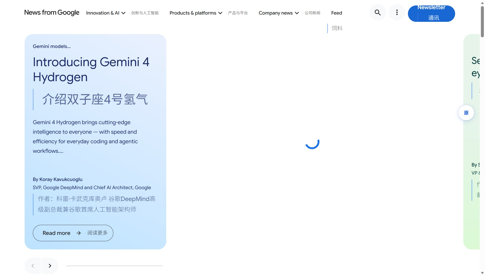
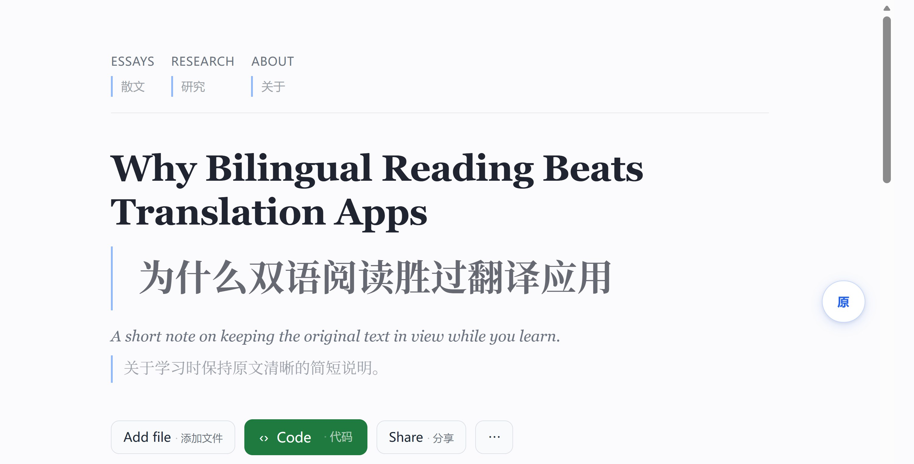
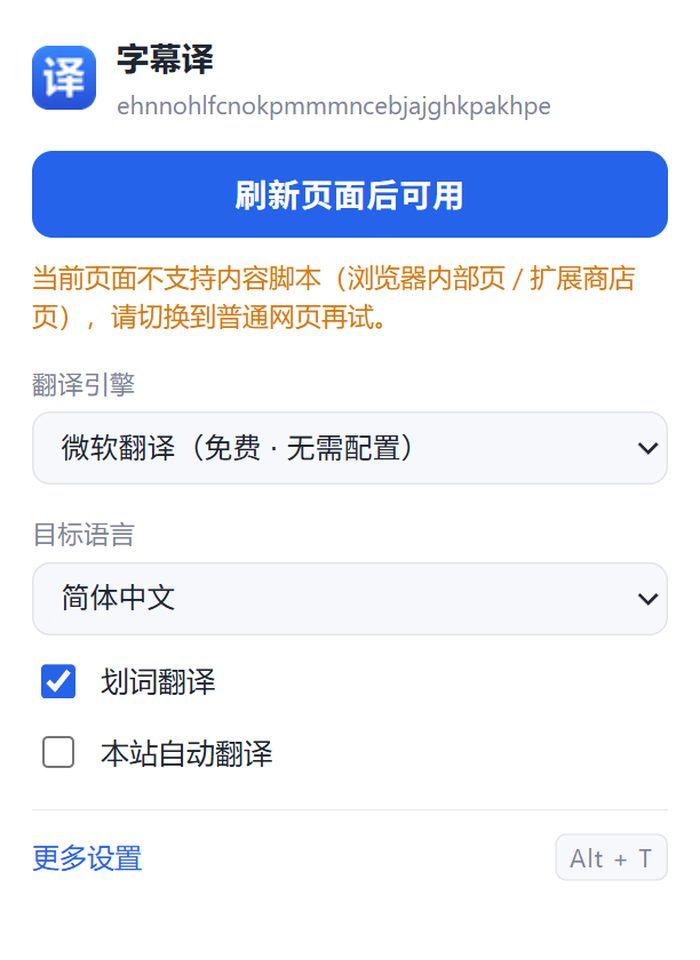
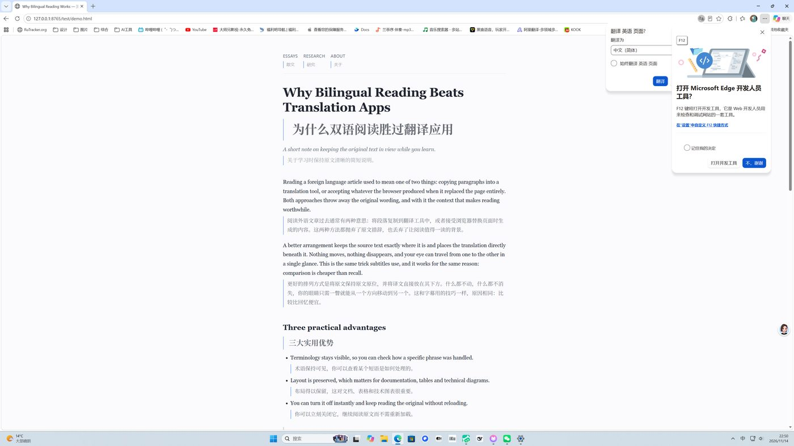

# 字幕译 · 双语对照网页翻译

一个轻量的浏览器翻译扩展：**把译文插在原文段落下方，不动原文一个字**，读起来像双语字幕。
页面右侧常有蓝色「译」悬浮按钮，点一下即译；也支持 `Alt + T` 快捷键、右键菜单、选中文字气泡翻译。
**按钮、菜单项、输入框这些界面控件也会跟着翻**（原文保留，中文以小一号灰字跟在后面）。

> 状态：v1.2.0，已在 Edge（Chromium 内核，与 Chrome 同一套 MV3 接口）实测通过。
> 实测数据：MDN 文档页 107 段 / 8.1 秒 / 0 失败；本地测试页 40 段 / 2 秒 / 0 失败。





<p align="center">
  
  
</p>

---

## 一、安装（30 秒）

1. 打开浏览器扩展管理页
   - edge://extensions
   - chrome://extensions
2. 打开右上角/左下角的 **开发者模式**
3. 点 **加载解压缩的扩展**，选择本文件夹 `浏览器翻译插件`
4. 把「字幕译」固定到工具栏，即可使用

> 更新代码后，需要在扩展管理页点一下该扩展的 **重新加载**（或重启浏览器），新功能才会生效。

> 需要读取本地 `file://` 网页时，还要在扩展详情里打开「允许访问文件网址」。

### 关于「自动安装」

Chromium 内核浏览器不允许程序静默启用扩展（安全设计），但可以用启动参数把扩展写进配置，省掉「加载解压缩」这一步：

```bash
node tools/install-extension.mjs edge   # 写入 Edge 配置
node tools/install-extension.mjs ego    # 写入 ego lite 配置
```

脚本会正常关闭浏览器 → 带 `--load-extension` 启动一次 → 检查配置是否写入 → 恢复会话打开。

实测差异：

| 浏览器 | 结果 |
| --- | --- |
| ego lite | 写入后**直接启用**，后台已启动（`has_started_service_worker` 有记录），重启后仍然有效 |
| Edge | 写入成功但被标记停用（`disable_reasons = 2²⁴`）。这是 Edge 对开发者模式扩展的强制限制，**必须手动把扩展页的「开发者模式」打开**，扩展才会启用 |

Edge 的开发者模式开关由浏览器自己守护，外部改 `Preferences` 会被覆盖，目前没有可靠的绕过方式。

**Edge 的正确顺序（实测踩过的坑）**：先在扩展页打开「开发者模式」，**再**点「加载解压缩的扩展」选择本目录。
这样加载的扩展会出现在「来自其他源」分组、开关自动打开、重启浏览器后依然有效。
反过来（先用启动参数写入、后开开发者模式）扩展会带着 `disable_reasons = 2²⁴` 的停用标记，
扩展页甚至可能不渲染它的卡片——此时再走一遍上面的手动加载流程就能恢复。

### ego lite 的特殊情况

ego 的扩展页是精简版，**没有「开发者模式」开关，也没有「加载解压缩的扩展」按钮**，
只能靠启动参数加载：

```
ego.exe --load-extension="D:\浏览器翻译插件"
```

所以本机已经把这个参数写进了 ego 的桌面和开始菜单快捷方式（原值备份在 `tools/lnk-backup.json`），
**双击桌面的 ego 图标就等于带扩展启动**，不需要额外操作。
如果以后重装了 ego 或新建了快捷方式，重新跑一次 `python tools/patch_ego_lnk.py` 即可。

## 二、使用

| 操作 | 说明 |
| --- | --- |
| 页面右侧悬浮按钮 | 任何网页右侧都有一个蓝色「译」按钮，**点一下翻译，再点还原**；可拖到任意位置，位置会记住 |
| `Alt + T` | 开启 / 关闭当前页面翻译（再次按下会完全还原页面） |
| 右键菜单 | 「字幕译：翻译此页 / 还原原文」「字幕译：翻译选中的文字」 |
| 按钮 / 菜单项 | 英文按钮、下拉项、标签页会追加小一号的中文，如 `Add file · 添加文件`，原文保留、点击行为不变 |
| 输入框 / 下拉框 | 占位符、提交按钮文字写成 `原文 · 译文`，光标进去不会覆盖你的输入 |
| 点工具栏图标 | 弹窗里可切换引擎、目标语言、划词开关、本站自动翻译 |
| 选中文字 | 0.5 秒内弹出译文气泡，带「复制」按钮 |
| 设置页 | 配置 AI 模型 Key、译文字号/配色/左边框、悬浮按钮开关、自动翻译站点、清理缓存 |

悬浮按钮三种状态：蓝色 `译`（未翻译）、转圈 + `翻译中 12/40`（进行中）、白底蓝字 `原`（已翻译，点它还原）。
不想要这个按钮，可在设置页「交互 → 悬浮按钮」关掉。

快捷键可在 `chrome://extensions/shortcuts` 改。

## 三、翻译引擎

| 引擎 | 是否免费 | 说明 |
| --- | --- | --- |
| 微软翻译（默认） | 免费免配置 | 走 Edge 网页翻译的免鉴权端点，质量好、速度快 |
| AI 模型 | 自备 Key | OpenAI 兼容接口，一次请求翻多段，术语最连贯。推荐 DeepSeek |
| Google 翻译 | 免费免配置 | 国内网络通常不通，作为备用 |
| MyMemory | 免费免配置 | 限流严格，仅作最后兜底 |

**自动降级**：默认链路是 `微软 → Google → MyMemory`。某一片请求失败会自动换下一个引擎重试，不会整页卡死。若选择 AI 引擎，则只走 AI（未填 Key 会明确提示）。

AI 引擎填写方式（设置页）：

- 接口地址：`https://api.deepseek.com/v1`（也可填硅基流动、智谱、Kimi、OpenRouter、本地 Ollama 等兼容地址）
- 模型名：`deepseek-chat`
- API Key：`sk-...`

密钥只存在本机浏览器存储里，请求从浏览器直接发给服务商，不经过任何中间服务器。

## 四、它到底怎么工作的

```
TreeWalker 遍历 → 筛出「叶子块级段落」 → 过滤（代码块/表单/隐藏/已是中文）
      ↓
另一条通道：按钮 / 表单控件 → 内联小字译文（原文不动）
      ↓
每 6 段打成一个请求 → 后台多引擎调度 → 分片 + 缓存 + 失败降级
      ↓
在原文段落内部 append 一个 <span data-st-tr> → CSS 渲染成下一行译文
      ↓
MutationObserver 监听新增节点 → 增量翻译（SPA / 无限滚动 / 延迟加载）
```

关键点：

- **原文永不修改**。译文是新增节点，原文字节点、页面样式、事件绑定都不受影响。
- **按块级段落收集**，不是按文本节点切碎，语义完整，不会把一句话拆成几段翻。
- **界面控件单独一条通道**：`button`、`[role=button]`、`[role=menuitem|tab|option|switch]`、`summary`
  的译文以小一号灰字追加在原文后面（`Add file · 添加文件`），不改按钮结构、不挡点击；
  占位符、下拉选项、提交按钮文字写成 `原文 · 译文`；纯图标按钮（没有文字）不处理。
  按钮里如果带文字图标（`‹›`、`⋯`、`→`），会先把首尾符号削掉再送翻译，避免图标被当成正文。
- **译文与原文相同就不显示**（`HTML → HTML`、`Web API → Web API`），不会出现两遍一样的字。
- **有缓存**：同一段文字只翻一次（`storage.local`，上限 4000 条），重复访问和页内重复文案都不再请求。
- **失败可见**：任何一段翻失败会在原位显示「点击重试」，不会静默吞掉。
- **样式隔离**：进度提示、划词气泡、悬浮按钮用 Shadow DOM，不受页面 CSS 影响。

### 目录结构

```
manifest.json              MV3 清单
icons/                     16/32/48/128 图标
src/
  shared.js                默认配置、语言代码映射、站点匹配（三端共用）
  background.js            多引擎翻译、分片、缓存、快捷键分发
  content/
    content.js             段落收集、译文插入、划词气泡、开关
    content.css            译文样式
  popup/                   工具栏弹窗
  options/                 设置页
test/
  demo.html                功能自测页（含动态插入、代码块、中文段落）
tools/
  e2e.mjs                  端到端测试（真实加载扩展跑断言）
  e2e-ui.mjs               界面与引擎连通性测试
  e2e-site.mjs             任意真实站点压测
  e2e-fab.mjs              悬浮按钮专项测试
  e2e-controls.mjs         按钮/表单控件专项测试
  make_icons.py            图标生成
```

## 五、已知限制

- **iframe 内的内容不翻译**（`all_frames: false`）。跨域 iframe 各站点权限模型复杂，先不做。
- **canvas / 图片里的文字**不在 DOM 里，插件拿不到，无解。
- 少数站点用极端的 `line-clamp`、`overflow: hidden` 或固定高度容器，译文可能被裁切。
- 极度动态的站点（每次滚动都重建整棵 DOM）会反复触发增量翻译，虽然有缓存兜底，但页面可能轻微抖动。
- 按钮加了内联译文后会变宽一点：宽度写死的工具条可能换行或挤到边界；输入框占位符过长时会被输入框自身裁掉尾部。
- 与所有同类插件一样，译文作为子节点存在，页面自身的 `textContent` 读取会包含译文。

## 六、开发与自测

```bash
# 本地静态服务（测试页）
python -m http.server 8765 --bind 127.0.0.1

# 端到端：加载扩展 → 触发翻译 → 断言 → 截图
node tools/e2e.mjs

# 悬浮按钮专项（存在 / 位置 / 点击开关 / 拖动记忆 / 设置开关）
node tools/e2e-fab.mjs

# 控件专项（按钮内联译文 / 占位符 / 下拉项 / 关闭还原）
node tools/e2e-controls.mjs

# 界面 + 各引擎连通性（需要 Edge）
node tools/e2e-ui.mjs

# 任意站点压测
node tools/e2e-site.mjs "https://developer.mozilla.org/en-US/docs/Web/API/Fetch_API"
```

测试脚本用 CDP 直连，不依赖 Playwright；截图落在 `test/`。

## 七、免责

内置的微软/Google/MyMemory 通道都是各站点网页端的非公开接口，可能随时变更、限流或失效（例如有道网页接口已于 2026 年下线，本项目已移除）。
对稳定性要求高时，请在设置页切到自备 Key 的 AI 引擎。翻译内容会发送到所选服务商，敏感页面请谨慎开启。
